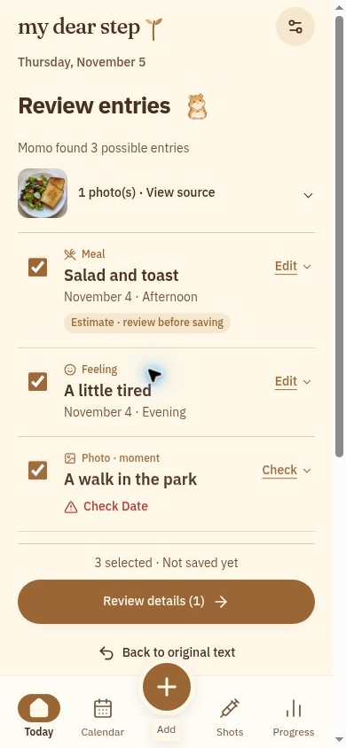
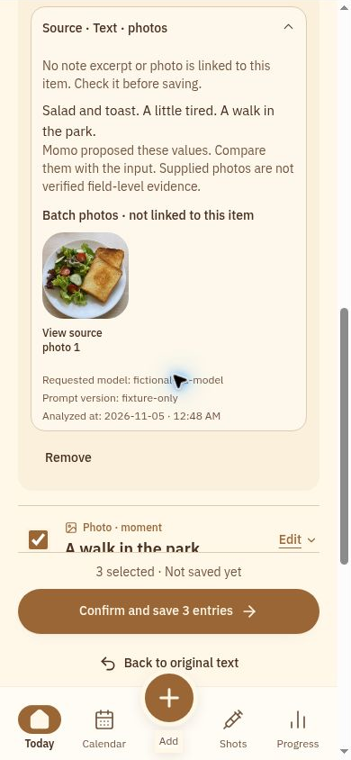

# my dear step 🌱

**Your everyday words and photos, organized into a journal you can check.**

Built for the **Meta AI Developer Hackathon**, My Dear Step is a Korean-first personal GLP-1 journal with Momo, an optional AI companion designed around **Meta Muse Spark Open**. Momo proposes editable entries from supplied text and photos. You choose what to keep, correct the details, and confirm before anything becomes a journal record.

[Open the app](https://my-dear-step-journal.lovable.app/) · [Hackathon presentation](docs/HACKATHON_PRESENTATION.md) · [Three-minute demo script](docs/DEMO_SCRIPT.md) · [Setup](docs/SETUP_AND_ENV.md)

> **Project status:** public hackathon prototype. The Meta integration is implemented, but the repository does not yet contain verified live-provider or deployed two-account privacy results. Screenshots below use fictional QA data. See [verification and limits](#verification-and-limits).

## The idea

A weight note, a meal photo, an injection log, a receipt, a moment worth remembering: small details are easy to scatter across a phone. Re-entering them into separate forms loses time and context.

My Dear Step brings them into one journal, with a clear boundary between **what was supplied**, **what AI proposed**, and **what the person confirmed**. The goal is simpler recording and a history people can revisit. It does not recommend treatment, medication doses, or nutrition targets.

## Capture → review → correct → confirm → revisit

1. **Capture naturally.** Type a note, attach photos, or use browser speech transcription where supported. Manual forms remain available.
2. **Review the proposals.** Momo returns selectable drafts. Missing facts and uncertain photo links stay visible.
3. **Correct the details.** Edit values and dates, inspect the original input, and leave out entries you cannot confirm.
4. **Confirm once.** Only selected, valid drafts become records. The app distinguishes local saving from account synchronization.
5. **Return to the source.** Reopen a dated record, inspect its original input and corrections, or find it again through history and search.

### A look at the review

<p>
  
  
</p>

_Local UI captures from the 4 November review pass. The records and generated salad/toast image are fictional fixtures, not live Meta outputs or personal health data. The source panel deliberately identifies the QA model as fictional._

## What you can do

| Area                 | Implemented workflow                                                                                                                                               |
| -------------------- | ------------------------------------------------------------------------------------------------------------------------------------------------------------------ |
| Daily journal        | Log weight, injections, condition, measurements, meals, moments and expenses.                                                                                      |
| Medication inventory | Track purchases and separate stock lots, with explicit units and user-controlled stock changes.                                                                    |
| Four mobile tabs     | Today, Calendar, Injections and Progress share one Quick Add flow and journal store.                                                                               |
| Momo capture         | Turn supplied text and supported photos into editable, source-linked draft entries.                                                                                |
| Meal logging         | Review possible foods and approximate energy ranges, then explicitly record the amount eaten. Estimates remain editable.                                           |
| Find past entries    | Use local keyword search or opt-in AI ranking of existing account records. Results open original dated entries.                                                    |
| Language and access  | Korean-first interface with English and French, guest manual logging, and signed-in synchronization.                                                               |
| Backups and recovery | JSON/CSV export, validated additive JSON import, targeted Undo, and explicit conflict/retry paths. Exports contain media references, not a complete photo archive. |

## Where Meta Muse Spark fits

The server-side adapter uses Baseten's Chat Completions API for four focused tasks:

- **Journal extraction:** propose structured drafts from explicit facts in notes and photos.
- **Meal estimation:** propose possible foods, portions and energy ranges, with uncertainty retained.
- **Memory retrieval:** rank a bounded set of owner-authorized records and return only validated existing IDs.
- **Optional contextual questions:** choose from eligible, constrained journal prompts. Actions remain defined by application code.

The model never writes directly to the journal. Application code validates the response, preserves missing values, computes meal totals, and requires user confirmation for saving. AI requires sign-in, explicit consent and a database-backed daily quota. Credentials stay on the server. Missing configuration produces an error rather than a fabricated result or silent switch to another provider.

**Model configuration:** `MUSE_MODEL` selects a supported Muse Spark Open model. The current code defaults to `meta-models/muse-spark-open-1026`; that alias is **not yet verified for the deployment's account**. [Setup instructions](docs/SETUP_AND_ENV.md#real-provider-verification-owner-action) describe the required smoke test. A displayed requested-model label is not independently confirmed provider identity.

Voice input uses browser transcription, not raw-audio inference by Meta.

## Architecture

```text
Text / browser transcript / photos
                ↓
Authenticated server function + consent + quota
                ↓
Meta Muse Spark Open via Baseten
                ↓
Validated proposals → editable review → explicit confirmation
                ↓
Local journal → signed-in sync to existing Supabase backend
                ↓
Calendar / history / search → original record and source
```

Manual entry joins the same journal without an AI request.

- **App:** React 19, TypeScript, TanStack Start/Router, Vite and Tailwind CSS.
- **Data:** existing Supabase/Lovable Cloud tables and owner RLS, localStorage snapshots, IndexedDB media, and private owner-folder photo storage.
- **Validation:** Zod schemas, bounded provider responses, one permitted JSON repair and a shared 45-second task deadline.
- **Checks:** Vitest, Testing Library, TypeScript and ESLint.

### Useful code entry points

| Concern                           | Source                                                                                                                                   |
| --------------------------------- | ---------------------------------------------------------------------------------------------------------------------------------------- |
| Provider, timeout and quota       | [`meta-provider.server.ts`](src/lib/meta-provider.server.ts)                                                                             |
| Extraction and draft validation   | [`momo.functions.ts`](src/lib/momo.functions.ts), [`momo-schema.ts`](src/lib/momo-schema.ts), [`momo-drafts.ts`](src/lib/momo-drafts.ts) |
| Review and retained evidence      | [`MomoSheet.tsx`](src/components/app/MomoSheet.tsx), [`SourceEvidence.tsx`](src/components/app/SourceEvidence.tsx)                       |
| Meal estimates and memory ranking | [`momo-tasks.functions.ts`](src/lib/momo-tasks.functions.ts), [`meals.ts`](src/lib/meals.ts)                                             |
| Optional contextual questions     | [`context-prompts.functions.ts`](src/lib/context-prompts.functions.ts)                                                                   |
| Durable records and sync          | [`journal.tsx`](src/lib/journal.tsx), [`cloud-sync.ts`](src/lib/cloud-sync.ts)                                                           |

## Run locally

Use **Node 22+** and Bun with the checked-in lockfile:

```sh
git clone https://github.com/Deytooh/my-dear-step-journal.git
cd my-dear-step-journal
bun install --frozen-lockfile
bun run dev
```

Open **http://localhost:8080/today**. Manual logging works as a guest. New journals start empty; demo controls load clearly labeled fictional records only after explicit confirmation. Use a disposable browser profile for demos and back up real data before any replacement.

Before enabling AI or cloud photos, follow [setup and environment](docs/SETUP_AND_ENV.md): preserve the existing backend, configure server-only credentials and an account-supported model, review the additive quota migration, and verify the private photo bucket and owner policies. Never put a privileged key in a `VITE_` variable or reset an existing database as a setup shortcut.

```sh
bun run test
bunx tsc --noEmit
bun run build
bun run lint
```

If dependencies are already installed, the equivalent npm scripts work. Keep `bun.lock`; do not create a competing lockfile.

## Verification and limits

- **Recorded local evidence:** the [5 November mobile optimization report](docs/MOBILE_PERFORMANCE_2026-11-05.md) documents 990 tests across 75 files, TypeScript and production-build passes, and changed-file lint without errors. Full lint reported 190 pre-existing formatting errors. These results belong to that documented snapshot, not every later commit.
- **Live checks still needed:** real Meta text/photo requests with the configured account, deployed two-account record/photo isolation, the intended hosted build, and physical-phone microphone, keyboard and enlarged-text behavior. Local mocks and screenshots do not establish these results.
- **Health boundary:** this is a personal journal, not medical decision support or an AI nutrition coach. No treatment benefit, dose recommendation, measured calorie accuracy or daily nutrition target is claimed.
- **Privacy boundary:** browser-local records and media are not encrypted at rest. Use a trusted browser profile. AI sends the selected task inputs to the configured provider after consent. See [assets and privacy](docs/ASSETS_AND_PRIVACY.md).
- **Storage boundary:** sync is a set of retryable operations, not one atomic multi-table transaction or real-time multi-device merging. Export before resolving conflicts. Retain original photos separately before clearing browser data. Backend media cleanup and account deletion remain administrative operations.
- **Hackathon status:** this project is prepared for the Meta AI Developer Hackathon. Public source and a presentation do not establish organizer eligibility, a submitted entry, a completed demo video or a verified deployment.

## Presentation and submission materials

- [Hackathon presentation](docs/HACKATHON_PRESENTATION.md): the problem, product, Meta integration, engineering choices and demonstration story.
- [Three-minute demo script](docs/DEMO_SCRIPT.md): one complete capture-to-source journey.
- [Submission copy](docs/SUBMISSION_COPY.md) and [contributions](docs/HACKATHON_CONTRIBUTIONS.md).
- [Dated verification status](docs/SUBMISSION_STATUS.md) and [release checklist](docs/RELEASE_CHECKLIST.md).
- [Setup and environment](docs/SETUP_AND_ENV.md) and [assets and privacy](docs/ASSETS_AND_PRIVACY.md).

## License and project history

Project source code is available under the [MIT License](LICENSE). Third-party dependencies, fonts, marks and artwork retain their own rights and licenses. The MIT license does not grant rights the project does not own; inherited asset provenance remains documented in [assets and privacy](docs/ASSETS_AND_PRIVACY.md).

This continues an existing Lovable-connected application. Lovable and Codex were development tools; the configured runtime AI path targets Meta Muse Spark Open through Baseten. See [contributions](docs/HACKATHON_CONTRIBUTIONS.md) for the distinction between the original project and later work. Preserve published Git history and the existing backend. The [historical master specification](docs/HISTORICAL_MASTER_SPEC.md) is archival; its instruction to create a new project is obsolete.
