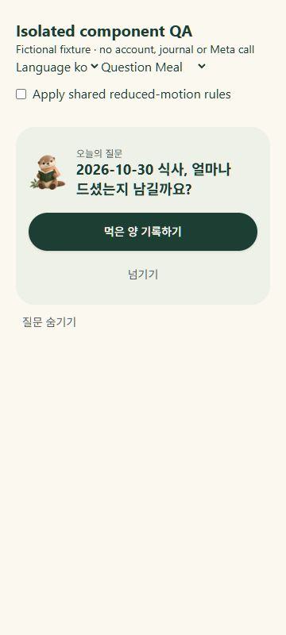
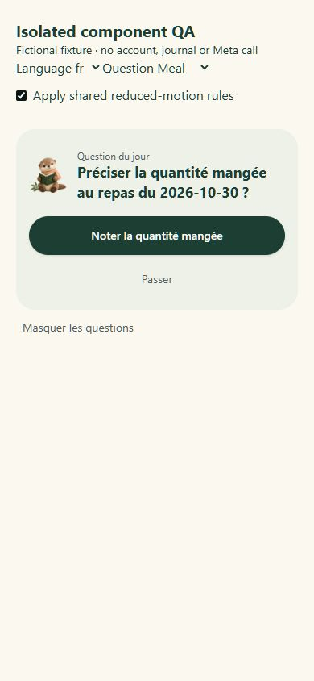
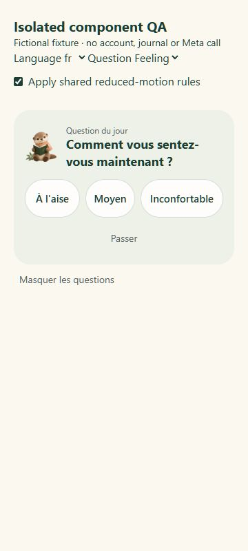
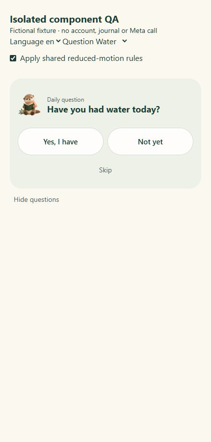
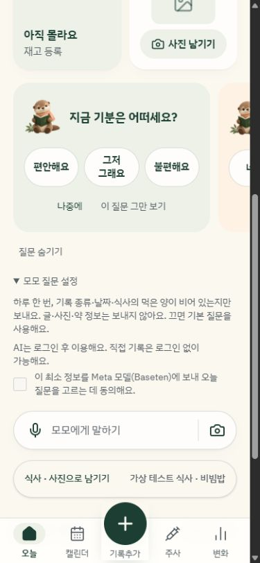
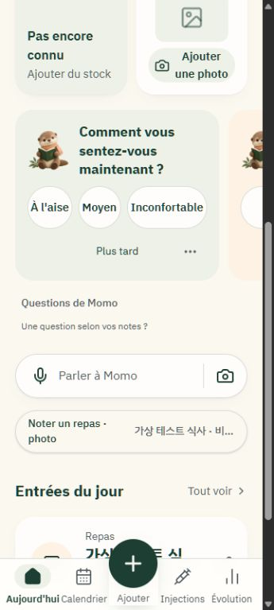
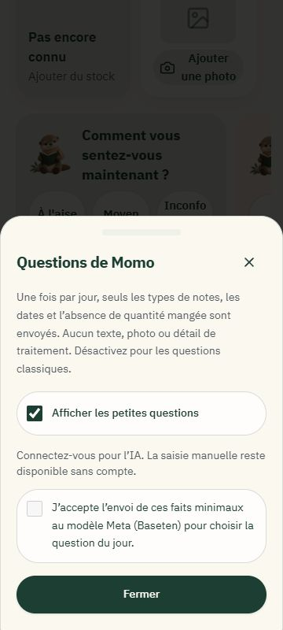
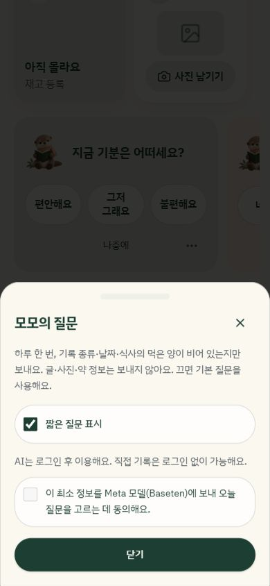
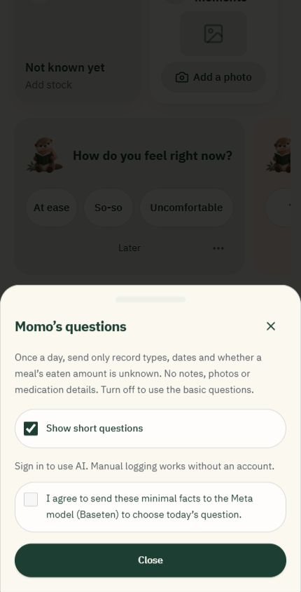

# Questions contextuelles de Momo

Implémentation ciblée ajoutée après `5217a9a`, sans reconstruction du journal, du carousel, des formulaires ou du provider Meta.

## Parcours

Les questions classiques restent actives sans IA et sans compte. Sous les cartes, « Questions de Momo » permet à une personne connectée de consentir explicitement à l’envoi des seuls faits nécessaires. Une seule carte contextuelle remplace alors le carousel. Désactiver ce consentement rétablit les cartes classiques ; masquer les questions conserve le réglage existant.

La fonction pure `opportunities` propose au plus cinq occasions : deux repas réels des sept derniers jours dont la quantité consommée est inconnue, puis les questions déterministes déjà éligibles (ressenti, eau, moment, poids). Les exemples de démonstration, dates futures, repas résolus et questions déjà traitées sont exclus. Aucun événement personnel n’est inféré d’une note, et aucune liste de consultation inexistante n’est ajoutée.

Préciser un repas ouvre son véritable formulaire d’édition, sans modification avant confirmation. Les réponses eau/ressenti passent par `respondPrompt`, qui enregistre ensemble la réponse et l’état contextuel. L’Undo inverse ces deux changements en préservant les entrées ultérieures. Ouvrir le formulaire souvenir/poids ne crée rien. L’affichage ne modifie aucun enregistrement du journal ; seul le cache technique de proposition est écrit.

## Sélection et confidentialité

Le serveur réutilise `metaJSON`, son modèle `MUSE_MODEL`, le timeout, la réparation JSON bornée et le quota existants. L’identité vient de l’authentification ; les entrées sont relues avec filtre propriétaire et la zone horaire est comparée au réglage du compte. Aucun titre personnel, note, citation, photo, reçu ou détail de traitement n’est envoyé à Meta : seulement identifiant d’occasion, type, date et quantité consommée inconnue.

Meta choisit une occasion et une courte formulation parmi deux variantes traduites, vérifiables et fournies par le code. Ce choix encadré est volontaire : une reformulation libre ne permettrait pas de garantir l’absence de faits ou conseils inventés. L’identifiant doit être autorisé ; les champs/actions supplémentaires sont rejetés. Une formulation non reconnue utilise la phrase déterministe de cette occasion. Les actions et leurs libellés restent définis par le code et les dictionnaires coréen/anglais/français.

## Fréquence et états

Le cache local est isolé par compte, langue et jour local. Une marque d’essai, indépendante de la langue, empêche les nouvelles tentatives automatiques du même jour ; une modification/suppression ne déclenche aucun nouvel appel. La migration `0003_context_questions.sql` réserve atomiquement une proposition par propriétaire/jour en base, y compris entre appareils, et conserve le résultat. Un échec consomme aussi la réservation. La réparation JSON du provider peut refaire une requête pour la même proposition ; elle ne crée pas une seconde proposition.

Proposée, répondue, passée, obsolète et désactivée sont des états distincts. Toute modification d’une entrée liée change son empreinte ; sa suppression ou sa sortie de la fenêtre d’éligibilité ferme la question. Une quantité consommée renseignée par un autre parcours marque la question résolue. L’Undo peut la rendre à nouveau actionnable. Une carte fermée laisse une confirmation neutre à la même place ; aucune nouvelle proposition n’est générée pour la remplacer.

Les effets sont isolés par compte/langue/jour/zone et nettoyés au changement de session. Une réponse tardive ne remplace ni la carte du nouveau compte ni une question déjà traitée. Le jour est recalculé au retour dans l’onglet et toutes les 30 secondes. Un changement de langue après la réservation quotidienne utilise le secours déterministe sans nouvel appel Meta.

## Vérifications

- 96 tests passent sur 15 fichiers, dont 21 nouveaux cas ciblés : occasions/résolution, identifiants inventés, données minimales, fréquence et minuit à Séoul, cache, états, invalidation, isolation/retards, formulaire exact, consentement, absence de mutation à l’affichage et Undo.
- TypeScript et build passent ; lint : 0 erreur, les 22 avertissements React Refresh déjà présents.
- 27 combinaisons visuelles : 360/390/430 px × ko/en/fr × repas/ressenti/eau. Pas de débordement horizontal ; cibles tactiles ≥44 px. Bouton français long corrigé. Hauteur avant/après réponse identique (224 px pour le ressenti ; 238,25 px pour le repas français à 360 px).
- Le banc d’essai temporaire utilisait le vrai composant de présentation et des données fictives, sans compte, enregistrement ni appel Meta. Les règles CSS exactes du mode mouvement réduit y ont été appliquées : transformations absentes et transitions à 0,01 ms. Cela ne remplace pas un test du réglage natif d’un téléphone. Le banc d’essai a été supprimé après vérification.

| Coréen 360 px | Français 390 px, règles réduites |
| --- | --- |
|  |  |

| Français 360 px, bouton corrigé | Anglais 430 px |
| --- | --- |
|  |  |

## Activation externe restante

Aucun appel Meta réel n’a été testé : `BASETEN_API_KEY` est absent de l’environnement local. Le modèle configuré reste `meta-models/muse-spark-open-1026` ; sa disponibilité n’est pas affirmée comme vérifiée.

L’inspection en lecture seule de la base Lovable connectée a confirmé les tables de journal existantes et l’absence de `momo_usage` et `momo_daily_questions`. Appliquer `drizzle/migrations/0001_momo_quota.sql` puis `0003_context_questions.sql` dans le projet existant, configurer la clé côté serveur et tester avec deux vrais comptes. Ces migrations additives sont préparées ; aucune migration de production ni publication n’a été exécutée. Sans elles, le secours déterministe reste utilisable et aucune erreur intrusive ne s’affiche.

Les tests serveur utilisent des doubles pour le provider, les requêtes propriétaires et la réservation persistante. Ils ne prouvent pas l’exécution des migrations, la concurrence SQL ni les politiques déployées avec de vrais comptes. Une vérification connectée et un contrôle sur téléphone restent à faire avant de revendiquer une validation de production.

Secours et consentement dans l’application complète, sans compte :

## Accueil allégé — après `62b5935`

L’accueil conserve seulement les cartes, un accès « Questions de Momo » et une invitation courte si le consentement manque. L’explication détaillée, le consentement explicite, l’affichage des questions et la restauration des questions masquées sont regroupés dans une sheet. Les contrôles équivalents ont été retirés du menu général pour éviter les doublons. L’accès à cette sheet reste présent quand les questions sont masquées, pour pouvoir les réactiver.

Chaque carte garde ses réponses principales et « Plus tard ». Le bouton « … », nommé pour les lecteurs d’écran, ouvre un menu avec l’action de masquage existante : un type de question classique, ou l’ensemble des questions pour une carte contextuelle. Les états, l’Undo et les règles d’enregistrement restent inchangés. La fermeture de la sheet rend le focus à son déclencheur.

Vérifications : 99 tests, TypeScript et build passent ; lint 0 erreur / 22 avertissements existants. Trois nouvelles régressions vérifient l’absence d’envoi à l’ouverture, le consentement explicite, l’accès aux options par menu et le masquage/rétablissement sans perte de focus. Contrôle dans l’application complète à 360/390/430 px, avec textes français, coréens et anglais : aucun débordement horizontal de la sheet, bouton de fermeture visible. Les boutons français longs ont été corrigés sans changer les valeurs sauvegardées. Aucun appel Meta réel ni migration de production dans cette passe ; les prérequis ci-dessus restent inchangés.

| Accueil à 360 px | Sheet à 360 px |
| --- | --- |
|  |  |

| Coréen à 390 px | Anglais à 430 px |
| --- | --- |
|  |  |
