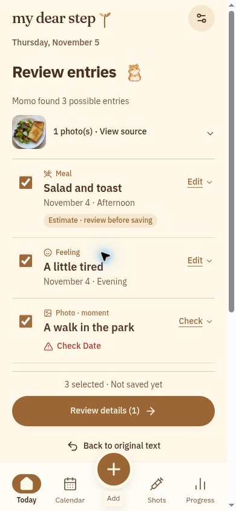

# My Dear Step

## Meta AI Developer Hackathon presentation

**Everyday words and photos become records you can review and memories you can revisit.**

[App](https://my-dear-step-journal.lovable.app/) · [Source and setup](../README.md) · [Demo recording script](DEMO_SCRIPT.md)

This is a repository-native presentation for judges and readers. It describes the implemented prototype. Live Meta inference, deployed privacy checks and the final video remain separate verification steps.

## 1. The problem: daily details lose their context

People tracking a GLP-1 journey may keep weights in one place, injection notes in another, and meals or meaningful moments in their camera roll. Turning those fragments into structured records takes repeated typing.

An AI-generated summary introduces another problem: it can sound certain even when an important fact was never supplied.

**Our starting point:** make recording easier while keeping the source and the person's decisions visible.

## 2. The product: a journal with a review step

My Dear Step combines a Korean-first mobile journal with Momo, an optional companion designed around Meta Muse Spark Open.

**Capture → review → correct → confirm → revisit.**

- Combine text and photos, or browser-transcribed speech.
- Scan selectable draft entries and visible missing-field warnings.
- Correct values, dates and source links before saving.
- Save only the selected, valid entries.
- Open the original record later and see the input and corrections.

_Local UI capture using fictional QA records and a generated meal image. It is not a live Meta result._

## 3. Meta's role: structure and retrieval

The implementation calls Meta Muse Spark Open through Baseten's server-side Chat Completions API.

| Task                 | What the model proposes                                          | What the application controls                                                         |
| -------------------- | ---------------------------------------------------------------- | ------------------------------------------------------------------------------------- |
| Journal capture      | Candidate entries from explicit text/photo facts                 | Schema validation, missing fields, source checks, editing and confirmation            |
| Meal log             | Likely foods, possible ingredients and approximate energy ranges | Editable items, explicit eaten fraction and deterministic totals                      |
| Memory search        | Relevant existing record IDs                                     | Owner-authorized candidate set, returned-ID validation and opening the original entry |
| Contextual questions | A question selected from eligible safe variants                  | Opt-in consent, verified facts, allowed actions and deterministic fallback            |

Model output has no direct write access to the journal. The provider adapter has a shared 45-second deadline, at most one JSON repair and a database-backed quota. API credentials remain server-side.

**Verification distinction:** the default requested model is `meta-models/muse-spark-open-1026`. An account-supported alias and live text/photo results must still be verified. A requested-model label or mocked test is not proof of live provider identity. There is no silent fallback to a non-Meta model.

Sources: [provider](../src/lib/meta-provider.server.ts), [extraction](../src/lib/momo.functions.ts), [meal and memory tasks](../src/lib/momo-tasks.functions.ts), [context questions](../src/lib/context-prompts.functions.ts).

## 4. A demo that shows the important decision

Use fictional text and an owned photo:

> Today I weighed 78.2 kg. This photo is my lunch, and I ate half. Yesterday evening I had an injection, but I do not remember the medication, dose or site.

1. Give consent and organize the input with the configured provider.
2. Review the proposed entries. Show that missing medication details remain unknown.
3. Correct the weight to 78.3 kg and check the amount eaten. Leave out an injection that cannot be confirmed.
4. Confirm the selected records once and show the actual save/sync state.
5. Reload and reopen Source to show the original 78.2 kg input and the user's correction.

**The moment to remember:** the person can see and change what the AI proposed before it becomes part of their history.

Run the [live smoke test](SETUP_AND_ENV.md#real-provider-verification-owner-action) before recording. If AI is unavailable, explicitly demonstrate manual entry instead and do not present it as live Meta inference. The [three-minute script](DEMO_SCRIPT.md) includes timing and fallback narration.

## 5. Engineering behind the workflow

- **One journal, one logging flow.** Four mobile tabs reuse Quick Add, shared forms and a common store.
- **Dates retain their meaning.** Timezone, local date and precision are preserved. An approximate evening is not turned into an invented clock time.
- **Sources stay inspectable.** Original text, supplied photos, proposed fields and confirmed edits are retained. Context photos are distinguished from explicitly linked evidence.
- **Saving is explicit.** Stable draft IDs and durable local writes support retry and targeted Undo. Local success and cloud sync are separate states.
- **Recovery is visible.** Account namespaces, conflict choices, retry actions and additive backup import are designed to avoid silently replacing records.
- **Manual entry remains useful.** The journal does not depend on a model being available.

Built with React, TypeScript, TanStack Start, Supabase/Lovable Cloud, IndexedDB, Zod and Vitest. This work extends an existing project; see [contribution history](HACKATHON_CONTRIBUTIONS.md).

## 6. Evidence and boundaries

The [5 November optimization report](MOBILE_PERFORMANCE_2026-11-05.md) records **990 tests in 75 files**, a TypeScript pass and a production-build pass for its snapshot. Changed-file lint had no errors; full lint exposed 190 pre-existing formatting errors. These are local engineering results, not proof of deployed security or every subsequent commit.

Still to verify: actual Meta requests, two-account cloud isolation, intended hosted revision, real-device voice/keyboard behavior and final video/portal status.

The product does not make treatment decisions, recommend doses, prescribe nutrition targets or claim measured calorie accuracy. Browser-local storage is not encrypted at rest. Structured backups contain references rather than a complete media archive. See [privacy](ASSETS_AND_PRIVACY.md) and [release checks](RELEASE_CHECKLIST.md).

## 7. What this prototype demonstrates

AI can help organize a personal journal while leaving the important decisions with the person who owns it:

**Reviewable proposals. Explicit confirmation. A source to return to.**

The repository is public and project code is MIT-licensed, with third-party rights retained. This is a project prepared for the Meta AI Developer Hackathon, not a claim of organizer endorsement, eligibility or completed submission.

[Explore the code](../README.md#useful-code-entry-points) · [Try the app](https://my-dear-step-journal.lovable.app/) · [Review the recorded evidence](SUBMISSION_STATUS.md)
