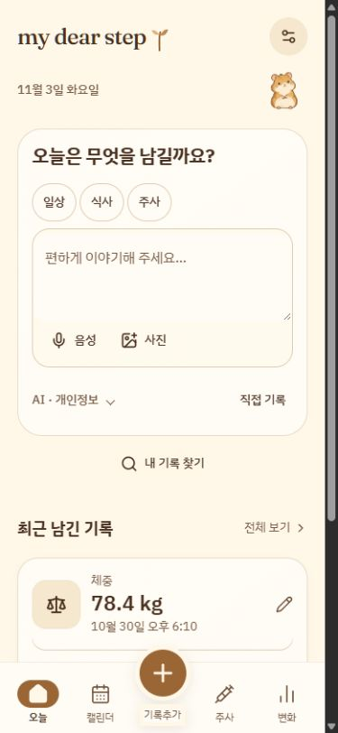
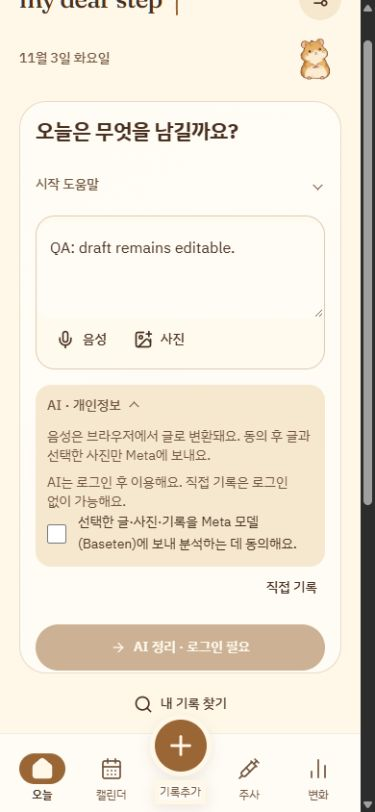
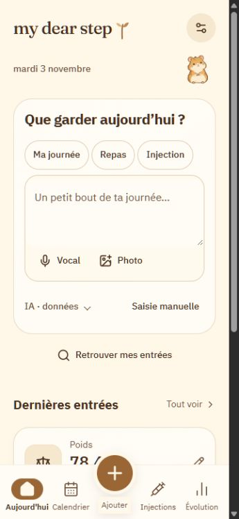

# Momo capture card — 3 November 2026

Scoped Product Design review of the user-supplied screenshot, followed by implementation in the existing shared MomoSheet.

1. **Empty composer — simplified.** Removed the repeated subtitle, introductory paragraph and visible local-guide disclaimer. Three short starter chips remain. The textarea and compact voice/photo toolbar share one surface; typing itself replaces the redundant Message button. Local suggestions remain local and placeholders never become source text.
2. **Guidance — progressive.** A selected chip reveals one invitation and existing quick replies. Once typing starts, the guide folds away. The existing textarea stays mounted and the draft remains editable.
3. **Privacy and actions — explicit.** Privacy and manual logging share a quiet footer. Expanding privacy reveals the existing unchecked consent and provider explanation. The primary organize action appears only when there is text or a photo; guests see a short sign-in-required label. No request is sent by selecting a starter or expanding consent. The consent CTA now targets its specific disclosure, independent of the writing-help disclosure.

## Verification and limits

Saved screenshots were opened and compared against the supplied screenshot. Korean at 390px and longer French labels at 360px showed no horizontal page overflow. Touch controls retain at least 44px height. Selected starter changed only the placeholder, with an empty textarea value. An editable QA draft revealed the real unchecked consent control; no model request or journal save was made. Console showed no errors in the inspected session. Existing synthetic QA records below the card were retained.

TypeScript, production build and focused ESLint used; no tests written or run. This is a focused visual/interaction check, not full accessibility certification. Real microphone, authenticated model analysis, native keyboard and cloud sync were not exercised in this presentation-only pass. The existing voice hook, evidence, journal and inventory rules were not changed.
