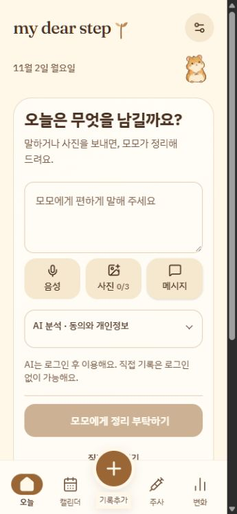

# Accueil Momo — 2 novembre 2026

## Parcours implémenté

`/today` conserve la navigation et présente une date locale, la petite mascotte canonique, le compositeur Momo partagé, un rappel uniquement si une échéance future existe et cinq entrées récentes (journal et achats). Les grandes métriques ont quitté l’accueil, leurs pages de suivi restent intactes. Les questions quotidiennes et leurs préférences restent disponibles dans une section secondaire repliée, montée uniquement à la demande.

Le même `MomoSheet` fonctionne dans l’accueil et depuis les autres pages. Sur l’accueil, le raccourci Momo de Quick Add rejoint le compositeur déjà monté : deux copies concurrentes ne réécrivent pas le même brouillon. Texte, photos et transcription du navigateur peuvent être combinés. Retour vers la saisie conserve les corrections et permet de reprendre les propositions sans nouvel appel. La récupération reste isolée par compte ; ses écritures sont regroupées pendant la frappe et vidées sur sortie/masquage. Les enregistrements confirmés restent écrits durablement et synchroniquement.

L’extraction authentifiée `extractWithMomo` réutilise `metaJSON`, Baseten, le modèle Muse Spark Open configuré, les quotas et limites existants. Elle accepte maintenant le type repas déjà présent dans le journal, dans le même lot que poids, ressenti, injection, mesure, souvenir et dépense. Le jour local et le fuseau sont explicites. Les repas passent par le schéma et le calcul existants, avec estimations identifiées et portion consommée inconnue tant que l’utilisateur ne la renseigne pas.

`MealItemsEditor` vient du formulaire repas existant et sert aux corrections manuelles comme aux brouillons Momo. Les autres cartes réutilisent MedicationPicker, SitePicker et SourceEvidence. Une clarification utile à la fois (champ indispensable ou portion facultative), exclusion réversible, sources, différences proposées/corrigées et avertissements de doublons précèdent une seule confirmation du lot. Les doublons proposés sont exclus par défaut et peuvent être explicitement inclus ; les références existantes s’ouvrent dans les vrais formulaires.

Les identifiants restent stables pendant récupération/retry. `saveMomoBatch` reçoit aussi le propriétaire attendu pour rejeter une confirmation périmée après changement de compte. L’analyse n’écrit rien dans le journal. Une injection Momo ne déduit aucun stock ; un reçu crée une dépense sans ajout d’inventaire. Les montants conservent leurs décimales et les quantités connues doivent respecter la règle entière positive du formulaire partagé. Les chaînes numériques ambiguës du modèle restent inconnues plutôt que de transformer une virgule décimale en une dose plus grande.

Après confirmation locale, la surface affiche le statut réel de synchronisation et les entrées réellement présentes, ouvrables par identifiant, avec Undo via le mécanisme de delta existant. Les citations sont des extraits exacts vérifiés côté serveur ; les indices de photos ne peuvent référencer que les images du lot. Les textes cités ne reçoivent pas automatiquement toutes les photos sans lien. Les sources originales et les corrections restent attachées aux entrées.

L’accès « Retrouver mes entrées » ouvre RecordFinder, distinct du compositeur. La recherche locale couvre aussi les valeurs de poids/mesures et les achats, porte une étiquette mots-clés et n’écrit aucune entrée. La recherche IA existante conserve son consentement et la validation des identifiants appartenant au compte ; aucune nouvelle infrastructure de recherche n’est ajoutée.

## Inspection réellement effectuée

- À 360 px : accueil vide après l’introduction existante, sans rappel inventé ni faux messages/données. À 390 px : capture et trois modes sans débordement horizontal. À 430 px : textes français et navigation lisibles.
- Dans un espace local séparé : texte non médical de vérification et image d’illustration locale combinés, passage vers Quick Add puis retour à Momo, contenu conservé ; rechargement conservant texte et photo.
- Recherche locale « QA » donnant les vrais repas et achats déjà présents dans cet espace ; saisie de recherche distincte de la capture, étiquette « mots-clés, pas IA ».
- Ouverture des vrais détails d’un repas récent, avec SourceEvidence et le nouvel éditeur partagé affichant les valeurs existantes 100.5–200.5 kcal. Aucune modification des entrées existantes n’a été enregistrée pendant cette passe.
- L’image Lovable canonique était absente du serveur local ; un proxy de développement restreint au chemin d’assets réutilise la source publiée existante, sans dupliquer le dessin ni transmettre cookies/Authorization. Le chargement du hamster a été observé avec une largeur naturelle non nulle.

## Vérifications et limites

Aucun test ni suite de tests n’a été écrit ou lancé. TypeScript, build et lint des fichiers modifiés ont été utilisés. Le lint global rencontre du formatage/fins de lignes déjà présent dans des fichiers non modifiés issus de GitHub ; ce n’est pas présenté comme une vérification globale réussie.

La session locale est invitée et ne possède pas de clé BASETEN_API_KEY. Aucun appel Meta réel, aucune transcription vocale effective, aucune permission microphone, aucune synchronisation cloud et aucune confirmation/Undo de lot provenant d’un résultat Meta réel n’ont été exercés ici. Le code est branché sur les intégrations existantes, sans faux résultat de remplacement ; ces parcours nécessitent une session connectée et une configuration valide dans l’environnement cible. Les tests de clavier physique et de changement réel entre deux comptes restent également externes.

Aucun déploiement, changement de visibilité, migration de schéma ou réécriture d’historique Git n’est effectué.
