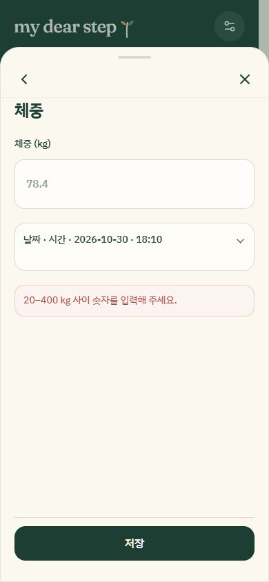
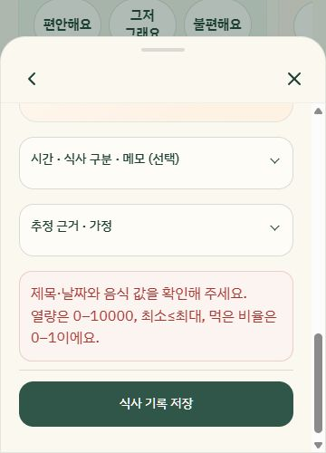

# Performance and entry-sheet fixes — 2026-10-30

Scope: preserve the cream/forest design, Momo, records, evidence and inventory rules while fixing shared entry-window behavior. Browser checks used a separate local origin (127.0.0.1:8081) with fictional QA entries; the existing localhost:8080 journal was not edited.

## Changes

- Entry sheets use the existing Radix dialog primitives with a stable 92% viewport height, one scrolling body and a separate header. Visual viewport resize/scroll updates keep the panel above the keyboard without competing drag or automatic input-repositioning logic. Focus starts on the dialog rather than automatically opening a keyboard. Header and body have separate stacking layers.
- New opening sessions reset form state even during a closing animation. Manual submissions have stable entry IDs, an immediate submission guard and disabled Save after success. Failed validation unlocks submission and focuses visible feedback.
- Manual and meal forms use their explicit validators instead of native validation silently preventing submission from collapsed fields. Decimal calorie inputs accept fractional values. Reminder dates/times receive explicit validation.
- Photo preparation blocks Save until complete, displays preparation status, and keeps meal attachments when other text fields are edited during processing. Photo decoding is asynchronous and offscreen images load lazily.
- Date and number formatters have bounded reuse caches; initial date/time form values are computed once. Latest-record selection takes one pass instead of sorting every matching record.
- Animation observation handles added/removed subtrees rather than scanning the entire document after every DOM mutation. Reduced-motion settings skip that observation. Large scrolling blur layers were removed from entry sheets, save bars and bottom navigation.
- Journal and Quick Add contexts live in stable modules. A reproduced development-update failure (`useJournal outside provider`) no longer occurs when updating the provider; home shortcuts also remain connected after an app-shell update.
- Stock adjustment labels display the selected lot's unit instead of always saying doses. No inventory accounting or persisted medication strings changed.

## Observed browser steps

1. **Open and switch entry views — healthy after fixes.** Checked menu, weight, condition, purchase, injection, stock, meal and Momo/manual fallback. The sheet keeps a consistent height. Back/Close remain available above the scrolling body. Momo consent remained unchecked and no AI request was sent.

   

2. **Invalid entry and correction — healthy after fixes.** Empty weight shows focused feedback; entering `78,4` saves one 78.4 kg record. Feedback remains visible above Save. Blank stock adjustment also reports its validation error, and selecting a lot fills its current balance.

   

3. **Purchase, injection and inventory — healthy in the checked sequence.** Purchase of two units created the selected product lot. Medication selection with Enter did not submit the form. Injection dose `2,5`, a selected site, an explicit compatible lot and checked deduction saved correctly. A double-click on Save created one injection and changed stock 2 → 1. Saving an unchanged edit kept stock at 1; deleting that injection restored 2. Selecting that lot in stock adjustment and saving its unchanged quantity also succeeded.

   

4. **Meal and constrained viewport — healthy in the checked sequence.** At 360 × 500, meal validation scrolls into view while Close and Save remain available. A meal with entered calorie bounds 100.5–200.5 saved successfully with a truthful device-only confirmation and unknown time. Its draft survived reload before saving. The calendar displayed the resulting entries.

   

## Performance evidence and verification limits

A Node microbenchmark against the previous HEAD's date helpers performed 2,000 local-date and 2,000 localized-date calls: **338.4 ms before, 11.1 ms after** on this machine. This measures date formatting only, not whole-app frame rate or loading time. The exact options and timezone semantics are unchanged.

Browser inspection covered 390 × 844, 430 × 932 and 360 × 500, including focus, scrolling, validation and saving. There was no horizontal document overflow in the measured menu and reduced-height flows. A real iOS/Android keyboard, device swipe gestures, large production datasets, cloud failures and live AI latency were not exercised. No automated tests were written or run, honoring the user's existing instruction. Static TypeScript, production build and lint checks are reported in the completion message.
