# Product UX check — 30 October 2026

Reviewed the current implementation after completion commit `1015b7e`, using the Product Design audit workflow. Captured the running local app before changes and inspected each saved screenshot. All directly observed issues in these eight steps were addressed; this is a scoped review, not an exhaustive accessibility certification.

Scope: Korean guest home → Quick Add → injection → Momo → existing fictional meal → recovery → inventory. Checked 360×800, 390×844, 430×900 and 390×500 (short viewport approximates available keyboard space). English and French menu checks supplement the Korean flow. Screenshots contain only fictional test content. Differences in width/scroll position are intentional; images are evidence of the stated interaction, not pixel-diff comparisons.

## 1. Home — Healthy in observed guest flow

The approved green header, cream cards, compact Momo and reachable central Add remain intact. Missing metrics invite logging instead of showing zero. The horizontal question carousel shows a next-card glimpse. At 430px, no horizontal page overflow was measured. No home styling change was needed.

| Before | After |
| --- | --- |
| 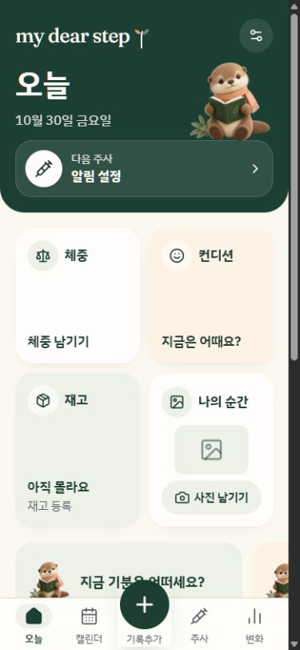 | 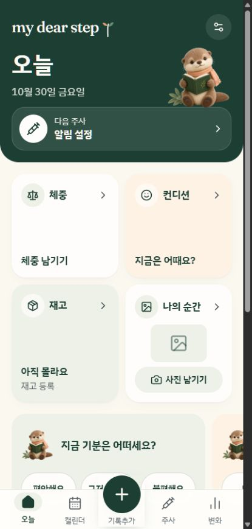 |

## 2. Quick Add — Fixed

The tall list hid less frequent actions and omitted manual water logging. Replaced it with eight compact cards, including water. At 360px all manual types are discoverable together; longer English/French content can scroll. Kept Momo as a separate action. The full card is the touch target.

| Before | After |
| --- | --- |
| 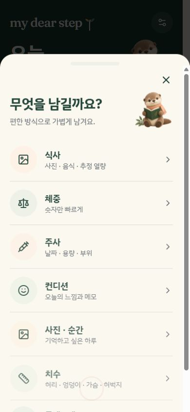 | 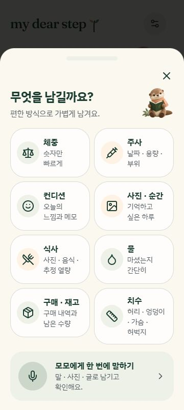 |

## 3. Injection details — Fixed

The dose-unit control had no accessible name. Dose and unit now have separate labels. Stock use is disabled until a compatible lot is selected; no-stock forms show an explanation. The neutral SVG, user-perspective labels, list alternative and unknown-site choice are preserved. Date/time remain collapsed but now show their current value in the summary.

| Before | After |
| --- | --- |
| 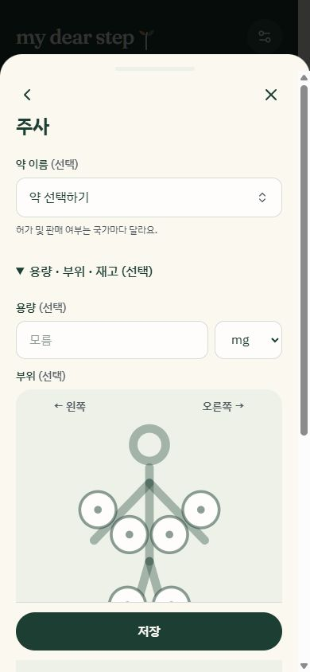 | 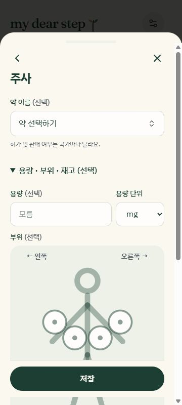 |

## 4. Momo input — Fixed locally; live extraction blocked

The guest route explained AI sign-in but offered no obvious general manual fallback. Added a visible manual button and sticky input/review/confirmation actions. Typed composition and photos now recover before extraction, not only after drafts exist. A 390×500 viewport check kept the composer and actions reachable. No AI request was sent; provider/account setup remains unverified.

| Before | After |
| --- | --- |
| 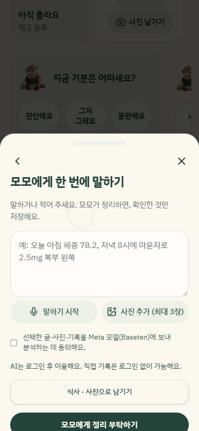 | 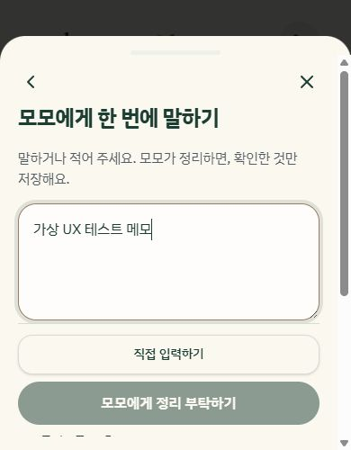 |

## 5. Meal review — Fixed

The generic batch-save label now says Save meal entry. Remove-food buttons identify the food. Existing estimate logic remains: fictional 500–700 kcal pictured, half consumed gives 250–350 kcal. Save stays visible at the bottom while details scroll. The supporting plain-color photo is an explicit test fixture, not a food-recognition result.

| Before | After |
| --- | --- |
| 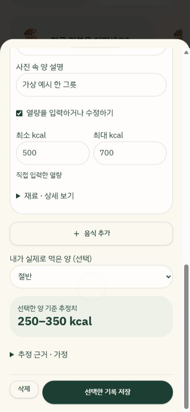 | 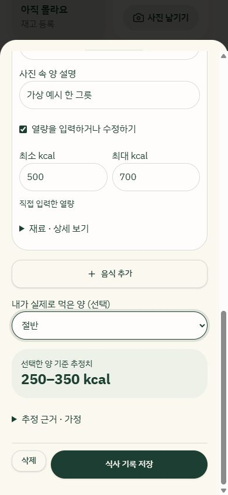 |

## 6. Recovered meal edits — Fixed

Previously an unsaved full-portion edit silently reopened over a saved half-portion meal. Recovery now explains the unsaved draft and offers Reset to saved entry (or Clear draft for new meals). Reset restored half and 250–350 kcal without modifying the saved journal. Unchanged saved meals do not receive a false unsaved-edit message. Reset is disabled during saving.

| Before | After |
| --- | --- |
| 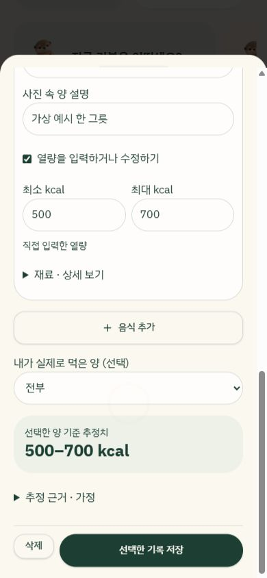 | 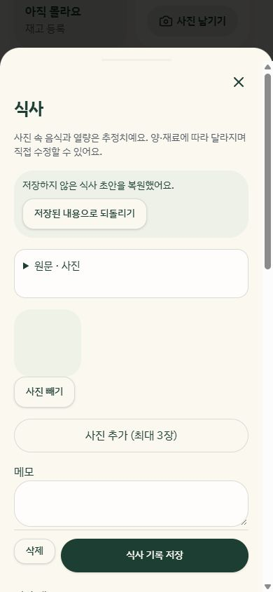 |

## 7. Inventory overview — Fixed

Unknown inventory remains unknown. With no lots, the action now says Add stock instead of Edit stock. Existing medication, unit and lot calculations are unchanged.

| Before | After |
| --- | --- |
|  | 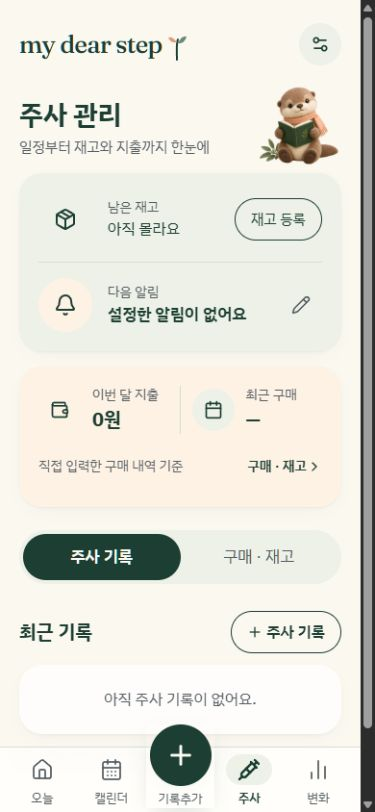 |

## 8. Empty-stock next action — Fixed

Edit previously opened an empty lot selector and left the user at a dead end. The no-lot action now opens purchase creation. Quantity/product confirmation and explicit inventory inclusion remain required; merely opening the form changes no stock.

| Before | After |
| --- | --- |
| 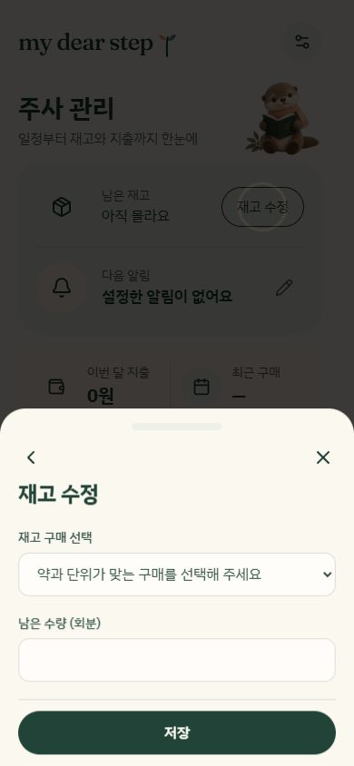 | 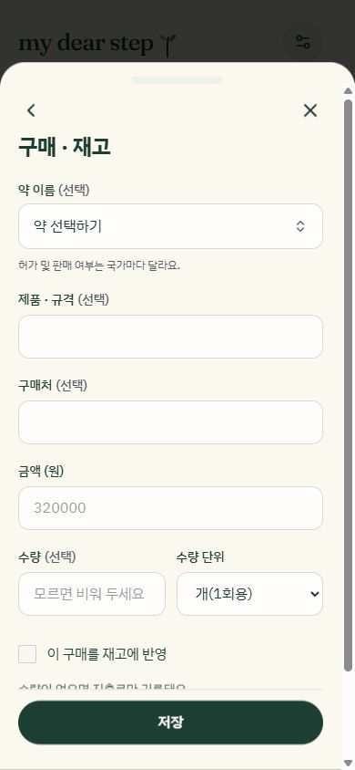 |

## Language checks

French's long measurement label wrapped inside a word in the new narrow card. Menu labels now use concise “Mesures” / “Body size” / “치수”; full record type names stay unchanged. All added strings exist in Korean, English and French.

| French, 390px | English, 360px |
| --- | --- |
| 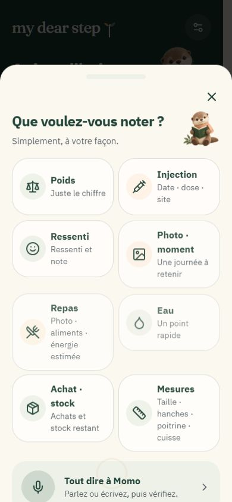 | 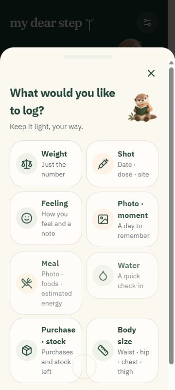 |

## Verification

- 75 tests passed across 12 files, including five new form/recovery regressions.
- TypeScript, production build and lint passed. Lint has 0 errors and the same 22 existing React Refresh warnings.
- UI checks confirmed named dose-unit controls, disabled invalid stock use, manual water access, reset-to-saved meal behavior, sticky actions in a short viewport and menu labels in all three languages.
- No database migrations, provider calls, deployment, visibility change or real health data were involved. GitHub push uses normal history-preserving commits.

## Limits and external checks

The live authenticated AI, successful cloud sync, deployed owner-only access with two accounts and private photo permissions were not exercised. They still require the configured backend/key and real test accounts described in SUBMISSION_STATUS.md. This pass did not record an actual submission video or submit to a portal.

Viewport resizing does not reproduce a phone keyboard, screen reader, OS large text or reduced-motion preference. Existing reduced-motion CSS was preserved and no new animation was introduced. Real-phone keyboard, large text, VoiceOver/TalkBack and reduced-motion checks remain necessary. Visual screenshots alone cannot prove complete contrast/focus/accessibility compliance. The development hot-update occasionally reset the provider boundary; clean reloads were used for accepted evidence, and production build passed.
