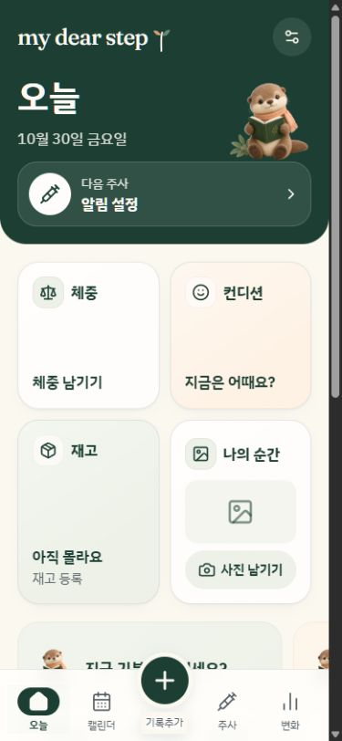
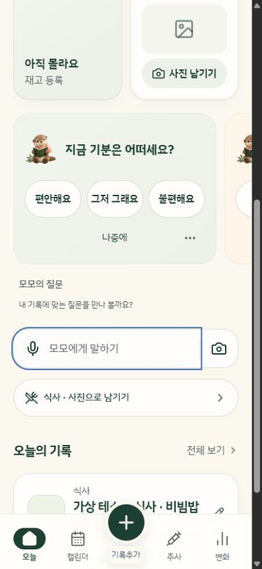
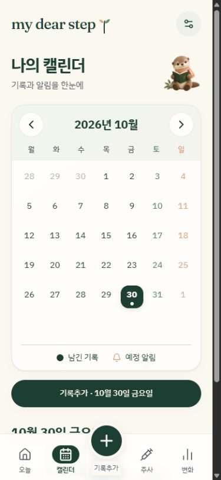
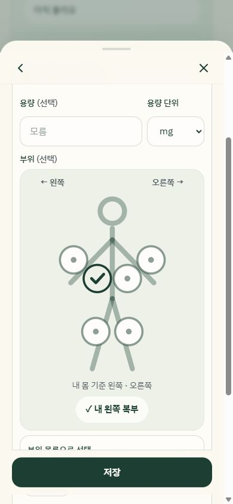
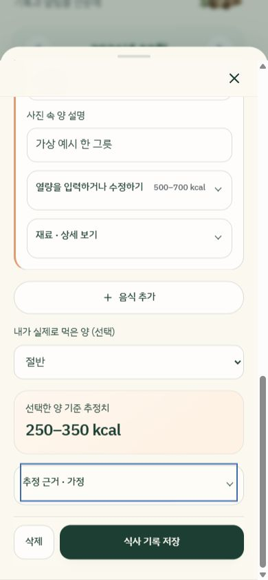
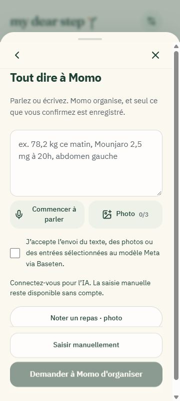
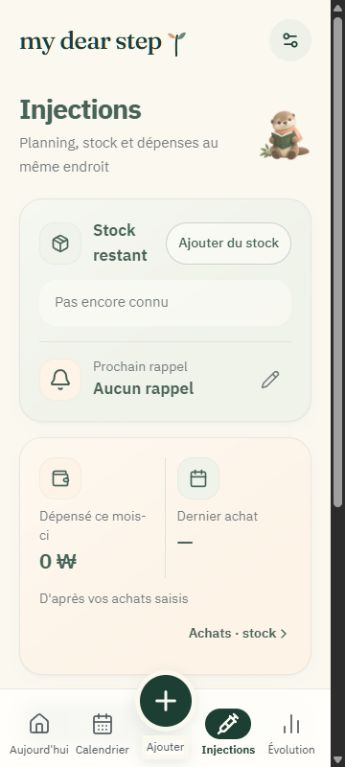

# Finition visuelle et interactive — 30 octobre 2026

Passe réalisée après `4b855ee`, directement dans l’application. Le header forêt, le fond crème, les assets Momo et la silhouette SVG neutre sont conservés. Aucun test créé ou exécuté, conformément à la demande.

- Styles partagés : surfaces bordées et dégradés discrets, rayons cohérents, typo coréenne, icônes et cibles tactiles ; pression sans déplacement du hitbox, sélections sobres, focus visibles.
- Navigation : repère actif forestier, bouton central affiné, labels français sans coupure, historique/souvenirs rattachés visuellement à Progression. Transitions de page de 180 ms et restauration du scroll existante conservée.
- Sheets et formulaires : backdrop plus léger, poignée compacte, fermeture persistante, actions de sauvegarde fixes, champs lisibles, groupes secondaires repliables. Une nouvelle vue de sheet revient en haut, sans réinitialiser ses valeurs lorsque des options se déplient.
- Accueil et questions : proportions des tuiles et de Momo ajustées, contraste et icônes harmonisés, capture mieux dessinée, accès repas simplifié, confirmations discrètes dans la place réservée.
- Momo et repas : choix voix/photo plus compacts avec vrai compteur de photos, aperçus soignés et suppression tactile, propositions structurées et sources dépliables. Titre du repas placé en tête, photos 4:3, aliments et champs d’estimation regroupés, vrais totaux affichés immédiatement.
- Injections/achats : lots toujours distincts, unités et quantités hiérarchisées, résumé financier plus lisible, devises formatées selon la langue sans conversion. Sélection du site avec teinte douce, contour et coche, orientation et alternative textuelle préservées.
- Calendrier, progression, historique et souvenirs : grille stable entre les mois, jours et marqueurs affinés, agenda et listes plus aérés, tooltips et périodes harmonisés, photos éditoriales et recherche IA placée dans un volet secondaire. Connexion harmonisée avec les mêmes champs et boutons.
- Chargement et motion : placeholders uniquement avant la disponibilité réelle du journal ; aucun faux zéro ou pourcentage. Animations courtes, disparition des rebonds/rotations décoratifs, loaders suspendus hors écran et onglet masqué, mode mouvement réduit respecté.

Les règles d’enregistrement, de consentement, de provenance, d’inventaire et les intégrations n’ont pas été modifiées. Les opérations réelles restent confirmées par leurs mécanismes existants. Aucun enregistrement n’a été ajouté ou supprimé pendant l’inspection.

Compilation TypeScript et build de production réussis ; lint : 0 erreur et 22 avertissements React Refresh préexistants. Aucun fichier de test modifié et aucune suite lancée.

Inspection dans le navigateur des sept écrans principaux à 360/390/430 px, ainsi que des sheets repas, injection et Momo, de la recherche locale et des libellés français longs. Aucun débordement horizontal de page relevé. La hauteur réduite de fenêtre sert seulement d’approximation du clavier : le clavier natif, les réponses IA connectées, les graphiques alimentés et les galeries avec plusieurs vrais souvenirs n’ont pas été inspectés. Aucun déploiement ni changement de configuration cloud.

Le repas visible est le cas fictif déjà présent, avec une photo de contrôle unie ; il ne s’agit pas d’un résultat IA simulé.

| Accueil | Questions et capture |
| --- | --- |
|  |  |

| Calendrier | Silhouette neutre |
| --- | --- |
|  |  |

| Repas : total réel | Momo en français |
| --- | --- |
|  |  |

